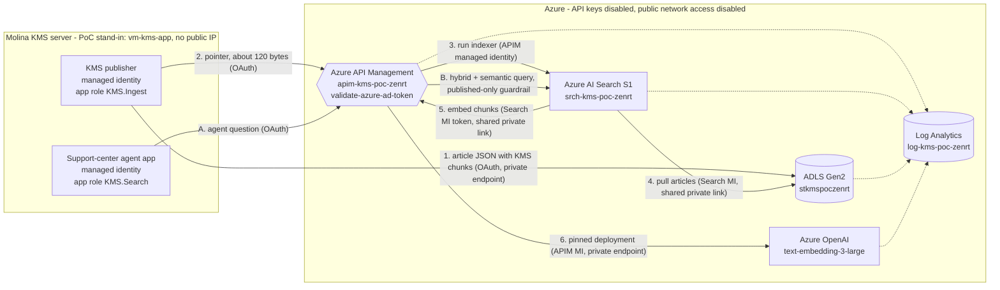
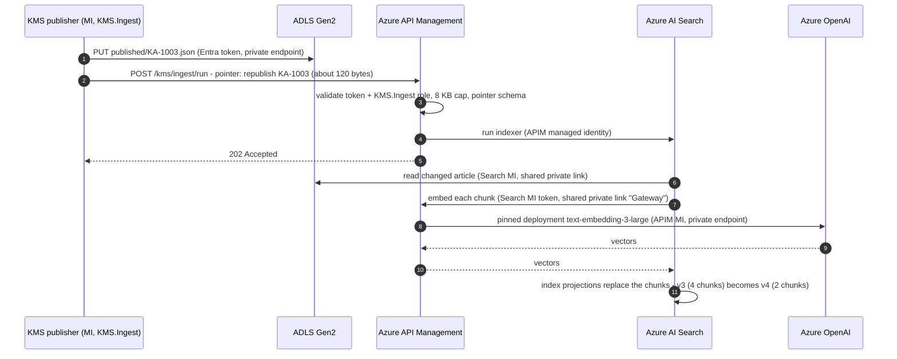

# Molina KMS: keyless AI Search ingestion and retrieval through Azure API Management

**Live demo runbook.** Audience: Kingslee (KMS owner); Molina Security (Luis, Sai, Jatin); Naren (delivery). From Microsoft: Andrew, Jaswant and Mark.

**One-command entry point:** from the repository root, run `.\final-demo.ps1` (or add `-Pause`). It runs the scenes below, resets the synthetic lifecycle baseline, restores the gateway setting and writes a fail-closed evidence summary. See the [root instructions](../README.md) for permissions, temporary network-setting changes and production-proof boundaries.

| | |
|---|---|
| Presenter | Jay Padhya, Microsoft Apps & AI |
| Length | 45–50 minutes. A 15-minute cut is in [section 4](#15-minute-cut). |
| Environment | Subscription `2852c4f9-8fcc-47c1-8e96-c4142a9ae463`, resource group `rg-molina-kms-search-oauth-poc-scus`, South Central US |
| Status | Built and verified end to end on Fri 30 Oct 2026. Every scene below passed in a full dry run. |
| Handling | Internal to Microsoft and Molina. Contains tenant and subscription IDs. Contains no secrets: every service has key authentication disabled, so there are none. |

---

## The 30-second version (say this first)

1. **The application path is keyless.** Storage Shared Key and account/service SAS are disabled; Search and Azure OpenAI local-key authentication are disabled. Storage user-delegation SAS is not disabled by `allowSharedKeyAccess=false`. The demonstrated callers use Entra ID (OAuth 2.0), including people, KMS, the agent app, Search and the gateway.
2. **The ingestion gateway carries a pointer, not the article/vector batch.** KMS writes each article with its existing chunk boundaries to ADLS Gen2, then sends a small pointer through the gateway. Embedding responses still carry vectors through the AI gateway. This removes the oversized ingestion-push request; model throttling and indexer limits still apply. The synthetic fixture preserves chunk boundaries but does not benchmark the production 700-token algorithm.
3. **Embeddings still go through the AI gateway.** AI Search's *built-in* Azure OpenAI embedding skill and vectorizer call Azure API Management over a shared private link, using a managed-identity token. APIM then calls Azure OpenAI with its own managed identity. There is no custom skill, no transform code and no secret.
4. **Nothing Kingslee relies on changes.** He keeps:
   - the custom chunking;
   - hybrid + BM25 + semantic ranking;
   - the Python `azure-search-documents` SDK;
   - filters on LOB, State and Effective Date.
5. **There is one gateway: Azure API Management.**
   - It is already Molina's AI gateway.
   - It is the gateway AI Search is documented to support for embeddings.
   - It is the only gateway AI Search can reach over Private Link.
   - Apigee in this path would add a second gateway, a stored credential and custom code, all for a 123-byte call.

---

## Contents

1. [Every ask, and where the demo proves it](#1-every-ask-and-where-the-demo-proves-it)
2. [Architecture](#2-architecture)
3. [Before the demo](#3-before-the-demo)
4. [Run of show](#4-run-of-show)
5. [One gateway: Azure API Management](#5-one-gateway-azure-api-management)
6. [Questions and objections](#6-questions-and-objections)
7. [Path to production by 4 Dec](#7-path-to-production-by-4-dec)
8. [What this PoC does not prove](#8-what-this-poc-does-not-prove)
9. [Cost, reset and teardown](#9-cost-reset-and-teardown)
10. [Appendices](#10-appendices)

---

## 1. Every ask, and where the demo proves it

| # | Ask or concern (who) | Answer | Proof |
|---|---|---|---|
| 1 | Security requires OAuth on every endpoint call (Luis, Security) | Keys are disabled on Storage, Search and Azure OpenAI. Only Entra tokens through APIM succeed. | Scene 1, Scene 2 |
| 2 | The KMS app uses an AI Search API key to create and update the index (Kingslee) | That stops working: Search rejects keys (401). KMS no longer writes to the index. It writes to ADLS and asks the gateway to run the indexer. | Scenes 2, 4, 7 |
| 3 | Full vectors through the gateway cause payload failures, throttling and 401s (Kingslee, Andrew) | A 4-chunk article with vectors is 139,847 bytes, and the gateway returns 413. The pointer is 123 bytes and gets 202. Vectors are created inside Azure. | Scene 4 |
| 4 | "Use ADLS for the files and send links in the gateway request" (Jatin, RITM7507292) | Implemented as written: an ADLS landing zone, plus a pointer contract that the gateway validates. | Scenes 3–5 |
| 5 | Confirm in writing whether integrated vectorization can call embeddings through APIM (Jay's commitment from the call) | **Yes. It is documented and running.** The *built-in* embedding skill and vectorizer accept an APIM endpoint. The private path is a shared private link with group `Gateway`. No custom skill is needed. | Scene 5, [5.6](#56-in-writing-the-documented-answer) |
| 6 | All model calls must go through the AI gateway (Security) | Azure OpenAI rejects keys and direct tokens. APIM's model API accepts only the AI Search identity. The logs show APIM's identity is the only successful caller. | Scene 2 (rows 6–8), Scene 9 (query 5) |
| 7 | Keep the custom 700-token chunking | Kept. KMS chunks are indexed as-is with index projections. There is no split skill. | Scene 5 |
| 8 | Keep hybrid, BM25 and semantic ranking | Kept: hybrid (keyword + vector) with the semantic reranker. | Scene 6 |
| 9 | Embedding model mismatch: the deployment is 3-large but responses report ada-002 | The gateway pins one deployment and returns `deployment_not_allowed` for any other. Index-time and query-time embeddings use the same API, so they cannot drift. | Scenes 5, 9; [6](#6-questions-and-objections) |
| 10 | Can AI Search reach an internal APIM? | Yes, through a shared private link (`Microsoft.ApiManagement/service`, group `Gateway`) and the private indexer environment. This requires an APIM instance that accepts private endpoints; see [5.4](#54-be-straight-about-the-caveats). | Scene 1, Scene 8 |
| 11 | How are old chunks removed when an article is republished? | Automatically. v3 (4 chunks) becomes v4 (2 chunks) with 0 stale chunks. | Scene 5 |
| 12 | How is an article retired? | Delete its blob (soft delete keeps it recoverable). Deletion detection removes the article and every chunk. | Scene 5 |
| 13 | Can Line of Business, State and Effective Date be filters? | Yes. They are filterable and facetable, shown live. | Scene 6 |
| 14 | Drafts ("Out for Validation"), expired articles and future-dated articles must not reach agents | A guardrail is enforced by the gateway and ANDed onto every query. A client cannot filter around it. | Scene 6 |
| 15 | Is the KMS VM in the VNet with no public IP? | Shown on the stand-in VM: it has no public IP, and every Azure name resolves to a private IP. | Scenes 1, 3 |
| 16 | Can KMS write to ADLS? | Yes, with its own identity, scoped to one container. Shared key is disabled. | Scenes 3, 5 |
| 17 | Will Security accept Entra RBAC without a gateway? (Luis) | Both are shown. Every service enforces Entra RBAC natively. The gateway adds:<br>- least privilege<br>- contract checks<br>- the guardrail<br>- the private-link switch<br>- one audit trail<br>We recommend the gateway path; RBAC-only is Plan B. | Scene 2, [5.5](#55-plan-b-if-luis-accepts-rbac-without-a-gateway) |
| 18 | What exactly fails: 413, 401 or a timeout? | Each status has exactly one meaning:<br>- 401: token<br>- 403: role, operation or private link<br>- 400: contract<br>- 413: payload<br>- 409: indexer busy | Scenes 2, 4, 7, 8 |
| 19 | The support-center Python app | It gets an identity with `KMS.Search` only. The SDK points at APIM with an Entra token, and the code is otherwise unchanged. | Scenes 6, 7 |
| 20 | Least privilege between the apps | The publisher cannot query (403) and the agent cannot ingest (403). Neither can call Search, Storage or OpenAI directly. | Scenes 3, 6 |
| 21 | Audit: who did what | One Log Analytics workspace records:<br>- every authenticated gateway call, with caller and roles<br>- rejections, with status and source IP (token failures name the policy)<br>- storage auth type and caller<br>- Azure OpenAI callers | Scene 9 |
| 22 | Private-only access | One switch makes APIM reject anything that does not arrive over its private endpoint. The KMS and agent path keeps working. | Scene 8 |
| 23 | Push batch limits: 16 MB or 1,000 docs per request in Search; about 10 MB in Apigee | No longer relevant, because nothing is pushed. The indexer pulls from ADLS (the S1 blob indexer accepts files up to 128 MB). | Scene 4 |
| 24 | Production on the shared dev service `sc-srch-digital-dev-01` | Disabling keys applies to the whole service and would break other teams. Use a dedicated production S1. | [6](#6-questions-and-objections), [7](#7-path-to-production-by-4-dec) |
| 25 | "No new Azure services" (Luis) | APIM, AI Search and Azure OpenAI are already in use. ADLS comes from Jatin's own guidance. Nothing else is added. | [5.3](#53-what-to-tell-jatin-ritm7507292) |
| 26 | VM now, AKS later; App Service is rejected | The identity code is host-agnostic: VM managed identity, Azure Arc, or AKS workload identity. | [6](#6-questions-and-objections) |

---

## 2. Architecture

Data goes through ADLS. Control and embedding calls go through Azure API Management with OAuth. Nothing in the path accepts an API key.



A republish, step by step (this is Scene 5):



### What stands in for what

| PoC resource | Plays the role of | In production |
|---|---|---|
| `vm-kms-app` (Ubuntu, no public IP, 10.60.3.4) | The KMS server (publisher) and the agent app's host | Molina's KMS server (SQL Server 2022 on a VM). Confirm whether it runs in Azure or in Molina's data center. |
| `id-kms-agent-app` (user-assigned managed identity) | The support-center Python agent app | That app's managed identity |
| `apim-kms-poc-zenrt` (Standard v2: inbound private endpoint, outbound VNet integration) | Molina's AI gateway | `gateway.prod1.apim.molina.mhc` (Sai), or a v2 instance for the AI Search path ([5.4](#54-be-straight-about-the-caveats)) |
| `aoai-kms-poc-zenrt`, deployment `text-embedding-3-large` | The backend of Andrew's embedding endpoint | Molina's Azure OpenAI behind APIM |
| `srch-kms-poc-zenrt` (S1, semantic ranker) | The KMS search service | A new, dedicated production S1 (not `sc-srch-digital-dev-01`) |
| `stkmspoczenrt` (ADLS Gen2, container `kms-articles`) | Jatin's landing zone | A new ADLS Gen2 account: private endpoint, shared key disabled, soft delete on |
| `log-kms-poc-zenrt` | Audit | Molina Log Analytics / Sentinel |
| Entra app `kms-ai-gateway-poc`, app roles `KMS.Ingest` and `KMS.Search` | The gateway's OAuth audience and roles | The same pattern in Molina's tenant |

---

## 3. Before the demo

### Over the weekend

- Leave everything running. It costs about $35 a day, mostly the APIM Standard v2 instance.
- Do one full dry run with `-Pause` on each script, in the order in [section 4](#4-run-of-show).
- Optionally, run `az vm deallocate -g rg-molina-kms-search-oauth-poc-scus -n vm-kms-app` to save about $2 a day. If you do, start the VM again at T-30, because Run Command needs it running.

### T-30 minutes

```powershell
az login --tenant 16b3c013-d300-468d-ac64-7eda0820b6d3
az account set --subscription 2852c4f9-8fcc-47c1-8e96-c4142a9ae463
cd "<this folder>\scripts"
Set-ExecutionPolicy -Scope Process Bypass -Force
az vm show -d -g rg-molina-kms-search-oauth-poc-scus -n vm-kms-app --query powerState -o tsv   # expect: VM running
# if not running: az vm start -g rg-molina-kms-search-oauth-poc-scus -n vm-kms-app
```

Terminal setup:
- Windows PowerShell 5.1 or PowerShell 7.
- At least 200 columns wide.
- Font 16 pt or larger for screen sharing.
- Close other windows that might show notifications.

### T-15 minutes: reset to baseline and warm up

```powershell
.\Set-PrivateLinkOnly.ps1 -State Off      # the gateway accepts the laptop again (it is Off unless a run was interrupted)
.\Demo-04-Republish.ps1 -Restore          # KA-1003 back to v3 (4 chunks), KA-1012 back in the index (about 1 min)
.\Demo-02-OAuthMatrix.ps1
.\Demo-03-Search.ps1
.\Demo-05-Payload.ps1                     # the warm-up calls also seed the logs that Scene 9 queries
```

The baseline is 43 chunks across KA-1001 to KA-1015, with KA-1003 at v3 and 4 chunks. Log Analytics lags 2–5 minutes, so the warm-up calls are what Scene 9 shows.

### Backup browser tabs

Open these in case a script misbehaves:
- **AI Search:**
  - Settings → Keys: API access control is *Role-based access control*.
  - Networking: public access *Disabled*.
  - Networking → Shared private access: three connections, all *Approved*.
- **APIM:**
  - APIs: *KMS Knowledge API*, *KMS AI Search (SDK pass-through, allow-listed)*, *KMS AI Gateway - Azure OpenAI embeddings*.
  - Named values: `kms-require-private-link`.
- **Storage:**
  - Configuration: *Allow storage account key access* is Disabled.
  - Data protection: blob soft delete is on, 7 days.
- **Azure OpenAI:** Networking: public access *Disabled*. (Demo-01 proves that keys are disabled.)
- **Entra ID:** Enterprise applications → `kms-ai-gateway-poc` → Users and groups shows the *people* assigned `KMS.Ingest` or `KMS.Search`. Managed-identity assignments don't appear in that blade; Demo-01 lists them.
- **Log Analytics:** `log-kms-poc-zenrt` → Logs.

> Do not open the index, indexer or Search explorer blades. They call the Search data plane from your laptop, and public access is disabled, so they show access errors. That is expected, but it looks broken on screen. If someone asks, that error *is* the proof.

Optional: `Start-Transcript -Path $env:TEMP\kms-demo-transcript.txt` keeps a record of the session.

---

## 4. Run of show

All commands run from the [scripts](scripts) folder. Every script prints `[PASS]` or `[FAIL]` lines and ends with a summary line. `-Pause` waits for Enter between steps, so you control the pace.

| Time | Segment | Command | Asks answered (section 1) |
|---|---|---|---|
| 0:00 | Opening | the diagram in [section 2](#2-architecture) | |
| 0:03 | Scene 1: There are no keys to steal | `.\Demo-01-Posture.ps1` | 1, 10, 15, 16 |
| 0:07 | Scene 2: The only way in | `.\Demo-02-OAuthMatrix.ps1 -Pause` | 1, 2, 6, 17, 18 |
| 0:11 | Scene 3: The KMS server's view | `.\Invoke-KmsVm.ps1 dns` and `posture` | 15, 16, 20 |
| 0:14 | Scene 4: Pointer, not payload | `.\Demo-05-Payload.ps1 -FromVm -Pause` | 2, 3, 4, 18, 23 |
| 0:18 | Scene 5: Republish and unpublish | `.\Demo-04-Republish.ps1 -Pause` | 5, 7, 9, 11, 12, 16 |
| 0:24 | Scene 6: Search quality and guardrail | `.\Demo-03-Search.ps1 -Pause`, then `Invoke-KmsVm.ps1 agent` | 8, 13, 14, 19, 20 |
| 0:29 | Scene 7: The SDK, unchanged | `.\Demo-07-SdkPassThrough.ps1 -Pause` | 2, 19 |
| 0:32 | Scene 8: Private link only | `.\Set-PrivateLinkOnly.ps1 -State On -ProveFromVm`, then `Off` | 10, 22 |
| 0:36 | Scene 9: Who did what | `.\Demo-06-Logs.ps1 -Pause` | 6, 21 |
| 0:40 | Why Azure API Management | [section 5](#5-one-gateway-azure-api-management) | 4, 17, 25 |
| 0:45 | Decisions and next steps | [section 7](#7-path-to-production-by-4-dec) | |

### Opening (3 minutes)

> "Last week's blocker was simple to state. Security requires OAuth on every call, and KMS uses an API key to write to AI Search. When you route those writes through a gateway, the vectors are too big, so you get 413s and throttling. Jatin's guidance was: put the files in ADLS and send links through the gateway. We built exactly that, end to end, and closed the last gap: AI Search makes the embedding calls itself, through APIM, privately, with no keys.
>
> Everything you'll see is live, in Azure, right now. Two things are stand-ins: a VM plays the KMS server, and the articles are synthetic copies of the KMS article shape."

Show the flowchart. Point out three things:
- Numbers 1–2 are the only things KMS does.
- Numbers 3–6 happen inside Azure.
- A–B is the agent app.

### Scene 1: There are no keys to steal (4 minutes)

**Run:** `.\Demo-01-Posture.ps1` (about 1 minute)

**Say:**
- "This reads the live configuration from Azure Resource Manager and Entra ID. These aren't slides."
- **Storage:** shared key and SAS are disabled, public network access is disabled, and it is ADLS Gen2 (hierarchical namespace).
- **Azure OpenAI and AI Search:** API keys are disabled and public network access is disabled. Search has a managed identity.
- **AI Search has three approved shared private links:** blob and dfs to ADLS, and `Gateway` to APIM. *"This is how AI Search reaches a gateway that has no public exposure."*
- **APIM has two private endpoint connections:** one for the VNet (the KMS server and the agent app) and one for AI Search. It calls backends with its managed identity.
- **The VM has no public IP.** I reach it only through Azure Run Command.
- **The RBAC and app-role tables at the end** answer "who can do what". Each identity has exactly one job.

**Expect:** every line is `[PASS]`, ending with `All posture checks passed.`

**If it fails:** the usual cause is an expired `az login`; log in again and re-run. As a fallback, walk through the portal tabs.

### Scene 2: The only way in is an Entra token through APIM (4 minutes)

**Run:** `.\Demo-02-OAuthMatrix.ps1 -Pause` (about 25 seconds without pauses)

**Say:** walk through the summary table the script prints at the end.

| # | Call | Result | Why |
|---|---|---|---|
| 1 | APIM, no token | 401 | `validate-azure-ad-token` |
| 2 | APIM, token for another audience (ARM) | 401 | The audience is pinned to the KMS gateway app |
| 3 | APIM, tampered token (role edited to `KMS.Admin`) | 401 | The signature check fails |
| 4 | APIM `/kms/whoami`, valid token | 200 | Echoes the audience, caller, roles and private-endpoint flag |
| 5 | APIM `/kms/search`, valid token with `KMS.Search` | 200 | The role check passes |
| 6 | APIM `/openai` embeddings with a person's token | 401 | Only the AI Search managed identity may call the model API |
| 7 | Azure OpenAI directly, API key | 401 | Keys are disabled |
| 8 | Azure OpenAI directly, Entra token | 403 | Public access is disabled; the only route is APIM's private endpoint |
| 9 | ADLS directly, Entra token | 403 | Public access is disabled |
| 10 | AI Search directly, API key | 401 | Keys are disabled. **This is today's KMS write path, and it stops working.** |
| 11 | AI Search directly, Entra token | 403 | Public access is disabled |

> "Row 11 is the one to remember. I hold Search admin roles for this PoC, and I still can't reach Search from the internet. Identity *and* network."

> "On 401 versus 413: in this design a 401 only ever means a token problem, and payload problems show up as 413. You can tell them apart instantly, and today you can't."

**Expect:** `All OAuth checks passed: the only way in is an Entra token through Azure API Management.`

### Scene 3: The KMS server's view (3 minutes)

**Run:**
```powershell
.\Invoke-KmsVm.ps1 dns
.\Invoke-KmsVm.ps1 posture
```
Each command takes about 35 seconds. Talk over the wait.

**Say:**
- "`vm-kms-app` plays the KMS server. It has no public IP, no SSH and no keys, and everything it does uses its managed identity."
- **dns:** blob, dfs, Search, Azure OpenAI and APIM all resolve to `10.60.1.x` private endpoints and show `PRIVATE`.
- **posture:** 10 checks.
  - Keys are rejected everywhere.
  - Direct token calls are rejected.
  - APIM's model API rejects the VM.
  - ADLS works with OAuth (`HTTP 200, 15 blobs`).
  - APIM accepts the VM's token with `roles=KMS.Ingest`, and `viaPrivateEndpoint=True clientIp=10.60.3.4`.
  - The publisher **cannot query** (`403 insufficient_role`).
  - A call with no token gets 401.

**Expect:** 5 lines marked `PRIVATE`, then 10 `[PASS]` lines.

### Scene 4: Pointer, not payload, the 413 fix (4 minutes)

**Run:** `.\Demo-05-Payload.ps1 -FromVm -Pause` (about 50 seconds without pauses)

**Say:**
1. **Today's pattern.**
   - "One article, 4 chunks, with 3,072-dimension vectors, is 139,847 bytes. One embedding alone is 34,883 bytes as JSON, about the size of the 32.7 KB embedding from last week's call."
   - "A full reindex of ~12,000 chunks pushes about 399 MB of vectors through a gateway."
   - The result is **413 `payload_too_large`** at an 8 KB cap.
2. **The gateway checks the contract, not just the size.** A bad action with an injection-style ID gets **400 `invalid_pointer`**.
3. **The pointer.**
   - It is 123 bytes, 1,136 times smaller, and gets **202 Accepted**.
   - It carries the response headers `x-kms-gateway: azure-api-management` and `x-kms-request-id`.
   - "KMS has already written the article to ADLS with its own identity."
4. **Indexer status through the gateway.** The KMS app needs **no Search role at all**.
5. **`-FromVm`:** the same comparison from the KMS server's identity over the private endpoint. It shows the same 34,883 and 139,847 bytes, and an 81-byte pointer.

> If the newest run shows `processed=0`, say: "KA-1003 hasn't changed since the last run, so there was nothing to do. The indexer only processes changed blobs, so re-sending a pointer is harmless."

**The pointer contract** (enforced by the gateway):
```json
{ "source": "kms", "action": "publish | republish | unpublish", "articleIds": ["KA-1003"], "correlationId": "<guid>" }
```
- `articleIds` takes 1 to 100 IDs. Each must match `^[A-Za-z0-9-]{1,40}$`.
- The body is capped at 8 KB.
- The caller needs the `KMS.Ingest` role.
- The gateway returns 409 if the indexer is already running; retry after 10 seconds.

**Batch limits (ask 23):** the push API's 16 MB / 1,000 documents per request, and Apigee's ~10 MB, no longer apply. Nothing is pushed: the indexer pulls from ADLS.

### Scene 5: Republish and unpublish with no orphaned chunks (5–6 minutes)

**Run:** `.\Demo-04-Republish.ps1 -Pause`. Use `-SkipUnpublish` if time is short. Each VM step takes about 40 seconds (the whole scene took 77 seconds in the dry run, without pauses). Keep the sequence diagram on screen and talk over the waits.

**Say:**
1. **Before:** KA-1003 (NEMT) is v3, with 4 chunks. These are KMS's own chunks, not ones Azure re-split.
2. **The KMS server writes v4**, now 2 chunks, to ADLS with its managed identity. It sends a pointer of about 140 bytes.
3. **AI Search pulls v4** over the shared private link. The built-in embedding skill calls **APIM**, and APIM calls Azure OpenAI with its own identity. *"This is the 'confirm in writing' answer, running: integrated vectorization through APIM with no custom skill."*
4. **After:** v4, 2 chunks, **0 stale chunks.** *"This answers 'how are old chunks removed'. You don't write any delete logic: index projections replace a parent's chunks."*
5. **The agent's answer now cites v4.**
6. **Unpublish KA-1012:** the publisher deletes the blob. Soft delete keeps it recoverable for 7 days. Deletion detection then removes the article and every one of its chunks.

**After the meeting:** run `.\Demo-04-Republish.ps1 -Restore` to put the baseline back. It takes about a minute, so there's no need to run it in front of the room.

### Scene 6: Search quality, filters and the published-only guardrail (5 minutes)

**Run:**
```powershell
.\Demo-03-Search.ps1 -Pause
.\Invoke-KmsVm.ps1 agent "member needs a ride to dialysis"
```

**Say:**
1. **"member needs a ride to dialysis"** returns KA-1003 NEMT first. Hybrid search plus the semantic reranker finds it even though the question shares no words with the title.
2. **The same question with `lob/any(l: l eq 'Medicare')`:** KA-1003 drops out, because it is Medicaid-only.
3. **Medicare + CA, "member has Medicare and Medicaid and the doctor sent them a bill":** returns KA-1006, Dual-Eligible / balance billing.
4. **Effective-date filter:** `effective_date ge 2026-01-01T00:00:00Z`.
5. **The guardrail.** The gateway enforces it and echoes it in the `x-kms-guardrail` response header:
   - 5a. KA-1011 (effective 2027-01-01) stays hidden until its date.
   - 5b. KA-1012 (expired 2026-06-30) is hidden.
   - 5c. A client that asks for `status eq 'out-for-validation'` gets **0** results, because the gateway ANDs the guardrail onto any filter. *"A draft can't leak, even if the app has a bug."*
   - 5d. All three are still **in the index**. The guardrail is a query-time policy; no data is missing.
6. **Facets** come from `GET /kms/stats`.
7. **The VM agent:**
   - The support-center agent identity (`KMS.Search` only) gets the answer.
   - When it tries to trigger ingestion, it gets **403 `insufficient_role`**.

**The guardrail:** `status eq 'published' and effective_date le now and (expiration_date eq null or expiration_date gt now)`

**Filterable fields:**
- `lob`, `state`, `category`, `status`, `version` and `article_id` are filterable and facetable.
- `effective_date`, `expiration_date` and `last_published` are filterable and sortable.

### Scene 7: The Python SDK keeps working, through APIM (3 minutes)

**Run:** `.\Demo-07-SdkPassThrough.ps1 -Pause`

**Say:**
- "These are the exact URL shapes the `azure-search-documents` SDK sends. Kingslee's agent app changes two things, the endpoint and the credential, and nothing else."
- Search (with the guardrail still applied), `$count`, and indexer status all return 200.
- Seven operations the apps must never perform return **403 `operation_not_allowed`**. The gateway is default-deny:
  - list indexes
  - read the schema
  - delete the index
  - upload documents (this would bypass KMS publishing)
  - look up a document by key (this would bypass the guardrail)
  - read skillsets
  - read service statistics

Show this snippet. It is illustrative and was not executed here; the script proves the URL shapes.

```python
from azure.identity import DefaultAzureCredential
from azure.search.documents import SearchClient
from azure.search.documents.models import VectorizableTextQuery

client = SearchClient(
    endpoint="https://apim-kms-poc-zenrt.azure-api.net/aisearch",   # was: https://<search>.search.windows.net
    index_name="kms-knowledge-v2",
    credential=DefaultAzureCredential(),                            # was: AzureKeyCredential("<api-key>")
    audience="api://4ef59d54-4c7f-48cb-9f14-cbf8ebd07652",          # token audience = the KMS gateway app
)
q = "member needs a ride to dialysis"
results = client.search(
    search_text=q,
    vector_queries=[VectorizableTextQuery(text=q, k_nearest_neighbors=10, fields="content_vector")],
    query_type="semantic", semantic_configuration_name="kms-semantic",
    filter="lob/any(l: l eq 'Medicaid') and state/any(s: s eq 'CA')",
    top=3,
)
```

### Scene 8: Private link only, with one switch (4 minutes)

**Run:**
```powershell
.\Set-PrivateLinkOnly.ps1 -State On -ProveFromVm     # about 1.5 minutes
.\Set-PrivateLinkOnly.ps1 -State Off                 # about 40 seconds; always turn it back off
```

**Say:**
1. The script flips the APIM named value `kms-require-private-link`. From then on, every API rejects traffic that does not arrive through the APIM private endpoint.
2. My laptop has a valid token but comes from the public internet, so it gets **403 `private_link_required`**. The SDK endpoint behaves the same way.
3. The agent on the VM still works over the full private chain:
   - VM → APIM private endpoint
   - APIM → AI Search
   - AI Search → shared private link → APIM
   - APIM → Azure OpenAI
4. *"Security chooses identity-only, or identity plus network. It's a policy switch that takes effect in seconds. It's not a re-architecture."*

### Scene 9: Who did what (4 minutes)

**Run:** `.\Demo-06-Logs.ps1 -Pause` (defaults to the last 120 minutes)

**Say:**
1. **Every authenticated gateway call:** the caller, its app roles, the operation, the private-endpoint flag and the status. These are the APIM trace records `kms-audit`, `kms-ai-gateway` and `kms-ingest-pointer`. Calls that policy refused *after* authentication appear here against a named identity: the agent's 403 on `ingest-run`, the publisher's 403 on `search`, and the 413 and 400 from Scene 4.
2. **Every rejection,** with its status and source IP. Token failures also name the policy (`validate-azure-ad-token`) and the reason (`TokenNotPresent`, `Validation Failed`).
3. **AI gateway embedding calls:** index time (the skill) and query time (the vectorizer), by caller and deployment.
4. **ADLS:** every request is `OAuth` and attributed to an identity:
   - AI Search reads;
   - the KMS publisher writes and deletes;
   - my own direct attempt is refused (403).

   The 403s on `GetBlobServiceProperties` are AI Search asking for account-level settings that its read-only data role deliberately doesn't grant. Indexing and deletion detection are unaffected (Scene 5).
5. **Azure OpenAI:** the only successful caller is APIM's managed identity, coming from `10.60.2.x`, APIM's outbound subnet. *"Nobody else can call the model."*

- For an ad-hoc query, run `.\Demo-06-Logs.ps1 -Kql "<query>"`.
- In production, these logs go to Molina's Log Analytics / Sentinel.

**If there are few rows:** logs lag 2–5 minutes. Re-run with `-Minutes 240`; the T-15 warm-up calls will be there.

### Closing: why Azure API Management (5 minutes)

Walk through the table in [5.2](#52-side-by-side). End on [5.3](#53-what-to-tell-jatin-ritm7507292).

### Decisions (5 minutes)

Use the decision list in [section 7](#7-path-to-production-by-4-dec).

### 15-minute cut

1. Scene 2: the OAuth matrix.
2. Scene 4: pointer, not payload.
3. Scene 5 with `-SkipUnpublish`.
4. Scene 8.
5. The table in [5.2](#52-side-by-side).

---

## 5. One gateway: Azure API Management

### 5.1 The position

> "Molina already has the right gateway. APIM is Molina's AI gateway today (`gateway.prod1.apim.molina.mhc`, owned by Sai). Andrew's embedding endpoint is on it. It is also the gateway Azure AI Search is documented to use for embeddings. Jatin asked the team to hold APIM until there was a design worked out with Microsoft. This is that design, and it implements his ADLS-plus-links guidance exactly."

The argument is **not** "Apigee is bad". Apigee can validate Entra tokens and enforce policies. The argument is that **the AI Search path has requirements only Azure API Management meets without custom code, stored secrets or public exposure**. Once APIM has to be in the path for embeddings, a second gateway for a 123-byte pointer adds cost and risk and gives nothing back.

### 5.2 Side by side

| Requirement | Azure API Management (proven in this PoC) | With Apigee in the AI Search path |
|---|---|---|
| AI Search's built-in embedding skill and vectorizer call the gateway | **Supported and documented.** The skill's endpoint must be Azure OpenAI, Foundry or APIM (`*.azure-api.net`). Running here (Scene 5). | Not an accepted endpoint for the built-in skill or vectorizer. It needs a custom Web API skill, a custom vectorizer, and request/response transformation code that Molina builds, tests and owns. |
| Private path from AI Search to the gateway | **A shared private link** of type `Microsoft.ApiManagement/service`, group `Gateway`. GA. Scenes 1 and 8. | AI Search shared private links target only the listed Azure resource types, and none is for Apigee. The embedding endpoint would have to be reachable from AI Search over the internet. |
| Gateway to AI Search and Azure OpenAI authentication (keys disabled) | **APIM's managed identity.** No secret exists to store, rotate or leak. | Apigee needs an Entra credential: a client secret or certificate stored in Apigee, or federation from Google Cloud to Entra. Security must approve, rotate and monitor it. |
| Network path to Search and OpenAI (public access disabled) | APIM's outbound VNet integration plus private endpoints | Apigee's runtime needs private connectivity into Molina's Azure VNets, plus DNS for the privatelink zones |
| Validate Entra tokens and app roles | `validate-azure-ad-token` (Scene 2) | Possible (VerifyJWT with JWKS). This is parity, so don't argue it. |
| Model governance | First-party AI gateway policies (per-caller token limits, token metrics, backend pools with circuit breakers for 429s), plus deployment pinning in policy | Custom policies |
| Least privilege on Search | APIM's identity holds the Search role, and the policy exposes exactly two indexer operations plus queries behind the guardrail (Scenes 6 and 7) | The same can be built, but only once Apigee holds an Azure credential (see above) |
| Audit | The same Log Analytics workspace as Search, Storage and OpenAI (Scene 9) | A second log pipeline to correlate with Azure logs |
| Gateways in the ingestion path | **One** | **Two:** Apigee for the pointer, and APIM (or nothing) for embeddings |
| New things Security must approve | Nothing beyond what Molina already runs | A new Apigee proxy, an Azure credential for it, and a network path from Apigee into Azure |

### 5.3 What to tell Jatin (RITM7507292)

Here is a draft that Kingslee can post or adapt:

> Jatin, following your 22 Oct guidance on RITM7507292, Microsoft and the KMS team built and tested the design end to end. KMS writes articles to ADLS Gen2 with its own Entra identity and sends only a ~120-byte pointer through the gateway, so no article content or vectors pass through any gateway. Azure AI Search pulls the articles from ADLS over Private Link and creates embeddings with its built-in Azure OpenAI skill. That skill calls our Azure API Management AI gateway over a shared private link, using a managed-identity token. API keys are disabled on ADLS, AI Search and Azure OpenAI.
>
> We recommend Azure API Management for both the pointer call and the embedding path, for three reasons:
> 1. It is the gateway Azure AI Search supports for its built-in embedding skill, and the only one it can reach privately.
> 2. It authenticates to AI Search and Azure OpenAI with its managed identity, so no credential is stored anywhere.
> 3. Every call is audited in one Log Analytics workspace.
>
> Apigee remains our standard for the APIs it serves today; it isn't needed in this path. Demo and details are available on request.

On "no new Azure services" (Luis):
- APIM, AI Search and Azure OpenAI are already approved and in use.
- ADLS is the component Jatin asked for.
- The Entra app registration, with two app roles, is configuration, not a service.
- Shared private links are private endpoints on Molina's own resources, approved by those resources' owners.

### 5.4 Be straight about the caveats

- **Molina's APIM tier and networking (ask Sai).**
  - Classic-tier APIM instances that are injected into a VNet (internal or external mode) **cannot accept inbound private endpoints**, so AI Search cannot reach them with a shared private link.
  - If `gateway.prod1.apim.molina.mhc` is classic and VNet-injected, add a **Standard v2 instance for the AI Search path**. That is exactly what this PoC runs: inbound private endpoint plus outbound VNet integration.
  - It is the same product, the same policies and the same team; this repo deploys its APIs and policies.
  - The cost is about $700 a month.
- **Custom domains.** Point the skill and vectorizer at `https://<name>.azure-api.net`, not the custom domain:
  - The embedding skill reference says APIM endpoints are supported "except for API Management custom domains". The APIM integration article lists custom domains as well, so the docs disagree, and the default hostname is the safe choice.
  - Over the shared private link, that name resolves privately anyway.
- **What APIM does not cover yet.** Per the docs, APIM is not supported as the gateway for:
  - the LLM behind an **agentic-retrieval knowledge base**;
  - the **Content Understanding** skill.

  The embedding skill, the vectorizer and the GenAI prompt skill are supported. KMS uses only the embedding skill and the vectorizer.
- **If Apigee must stay in the picture,** put it *in front of* APIM for consumers that already go through Apigee, passing the Entra token through. Never put it *instead of* APIM in the AI Search path.

### 5.5 Plan B, if Luis accepts RBAC without a gateway

This is Luis's open question, and we can answer it either way. Everything stays keyless:

- AI Search calls Azure OpenAI **directly**, over a shared private link of type `openai_account`, with its managed identity holding *Cognitive Services OpenAI User*.
- The agent app queries Search directly with *Search Index Data Reader*.
- KMS writes to ADLS as today.

**Why we still recommend the gateway:**
- Running an indexer without a gateway requires *Search Service Contributor* on the KMS identity. That role can create, change and delete **every** object on the search service.
- The gateway narrows it to "run this one indexer" and "read its status".
- The gateway also adds:
  - the published-only guardrail;
  - the pointer contract and size cap;
  - the private-link switch;
  - one audit trail.

### 5.6 In writing: the documented answer

> **Yes.** Azure AI Search integrated vectorization calls Azure OpenAI through Azure API Management. The built-in Azure OpenAI embedding skill, the Azure OpenAI vectorizer and the GenAI prompt skill all support an APIM endpoint. The recommended authentication is OAuth: APIM's `validate-azure-ad-token` checks the search service's managed-identity token, and APIM uses its own managed identity to reach Azure OpenAI. For a private path, create a shared private link from the search service to the APIM instance (type `Microsoft.ApiManagement/service`, group ID `Gateway`) and run the indexer in the private execution environment. No custom Web API skill is needed. This PoC runs that configuration end to end.

Sources:
- [Use Azure API Management with Azure OpenAI skills and vectorizers](https://learn.microsoft.com/en-us/azure/search/search-how-to-configure-azure-openai-api-management)
- [Azure OpenAI Embedding skill](https://learn.microsoft.com/en-us/azure/search/cognitive-search-skill-azure-openai-embedding)
- [Shared private link supported resource types](https://learn.microsoft.com/en-us/azure/search/search-indexer-howto-access-private)

### Don't say

Each of these is false or unprovable, and each will cost credibility in the room:
- "Apigee can't do OAuth or JWT."
- "Apigee is insecure."
- "APIM is always cheaper."
- "Shared private link is free." It is billed by usage, though the cost is small.

The winning argument is the integration, and it is already on screen.

---

## 6. Questions and objections

| Question | Answer |
|---|---|
| Why not just use Apigee? Security already approved it. | Security's rule is OAuth through *a* gateway, and APIM meets it (Scene 2). For this path, only APIM works with AI Search's built-in skill, Private Link and managed identity. See [5.2](#52-side-by-side). |
| Is the shared private link to APIM GA? | Yes. The only preview shared-private-link types are `managedInstance`, `mySqlServer` and `sites`. `Microsoft.ApiManagement/service` (group `Gateway`) is GA. Re-check the docs page on the day of the review. |
| Our APIM uses a custom domain. | Use the `<name>.azure-api.net` hostname for the Search → APIM hop ([5.4](#54-be-straight-about-the-caveats)). |
| Our APIM is internal (VNet-injected). | Then it can't take an inbound private endpoint. Use a Standard v2 instance for this path, or Plan B ([5.4](#54-be-straight-about-the-caveats), [5.5](#55-plan-b-if-luis-accepts-rbac-without-a-gateway)). |
| Can we stay on `sc-srch-digital-dev-01`? | Not for production. It is a dev-subscription service shared by many teams, and turning keys off (`disableLocalAuth`) applies to the whole service, which would break the other teams. A shared private link to APIM for embedding skills also needs:<br>- Basic tier or higher;<br>- a service created after 3 Apr 2024;<br>- a high-capacity region;<br>- no more than two embedding skills per indexer, or the indexer can't run in the private environment (this design uses one).<br>Use a dedicated production S1. |
| Do we lose the custom chunking? | No. KMS chunks are indexed as-is with index projections (Scene 5). |
| Do we have to re-embed? | Once, because index vectors and query vectors must come from the same model. About 12,000 chunks × ~700 tokens is ~8.4M tokens: roughly 24 minutes at 350K TPM in theory. Plan for about an hour; the token cost is negligible. |
| Which model built `kms-knowledge-v1`? | Unknown. The URL names `text-embedding-3-large`, but responses report `ada-002`. Ask Andrew and Sai to check the APIM backend. In this design the gateway pins one deployment (`deployment_not_allowed` otherwise), and the skill and vectorizer share the same API. |
| What changes in the KMS code? | Delete the embedding calls and the Search-key push. Add the two calls below: write the article JSON to ADLS, then send a pointer. |
| The KMS server is on-prem; it has no managed identity. | Two options:<br>- Make it an **Azure Arc-enabled server**, which gives it a managed identity. `ManagedIdentityCredential` in `azure-identity` handles Arc's local endpoint.<br>- Use an **Entra app registration with a certificate** held in the Windows certificate store, never a client secret.<br>For the network, use ExpressRoute or VPN to the VNet, plus DNS forwarding (Azure DNS Private Resolver) for the privatelink zones. |
| Is the AI Search managed-identity token a risk? | The embedding skill docs warn that a managed-identity token for the Foundry Tools (Cognitive Services) audience is valid against any Foundry Tools or Azure OpenAI resource the identity is authorized on. **Here, the AI Search identity has no Azure OpenAI role at all;** only APIM's identity does. So the token is useful only at our gateway, which pins one deployment. Also restrict who can edit skillsets (*Search Service Contributor*), because the skillset decides where the token is sent. |
| APIM's identity has *Search Service Contributor*. Isn't that broad? | It belongs to the gateway, not to an app, and the policy allow-list limits what callers can make it do (Scene 7). For production, evaluate a narrower custom role. |
| 429s and throttling on Azure OpenAI? | To avoid frequent 429s, the embedding skill docs themselves recommend **API Management load balancing across multiple embedding deployments** (APIM backend pools with circuit breakers). The PoC also applies a per-caller token limit (1M TPM, keyed by the caller's app ID). |
| 401 vs 413? | 401 always means a token problem; 413 means payload size. Ask Kingslee for the exact codes from the current failures, for the record. |
| Images inside articles (OCR)? | Phase 2. The same skillset can add OCR, and nothing in this design blocks it. |
| Benefit PDFs (~50 pages)? | Phase 2, with the same pull pattern: drop the PDFs in ADLS and add a second indexer with document cracking and layout or split skills. |
| The KMS portal is HTTP. | TLS is needed before go-live. It is separate from this design, but it is on the list. |
| What about SQL Server 2025 or PostgreSQL instead? | Keep AI Search for 4 Dec. The problem was the authentication and data path, not the search engine. SQL 2025 or Postgres is a phase-2 evaluation (Jaswant), and it would lose built-in hybrid fusion and the semantic reranker. **Correction to the Copilot recap:** SQL 2025 was not Jay's "preferred" path. |
| VM now, AKS later. Does this change? | No. The code uses `ManagedIdentityCredential` / `DefaultAzureCredential`, which works on a VM, on Azure Arc, and on AKS with workload identity. App Service isn't needed. |
| Can Security turn on private-only later? | Yes. It is one named value and takes effect in seconds (Scene 8). |

**KMS publisher change.** This is illustrative Python; a .NET version uses `Azure.Identity`, `Azure.Storage.Files.DataLake` and `HttpClient` the same way.

```python
import json, requests
from azure.identity import ManagedIdentityCredential          # Azure VM, Azure Arc or AKS workload identity
from azure.storage.filedatalake import DataLakeServiceClient

cred = ManagedIdentityCredential()
fs = DataLakeServiceClient("https://stkmspoczenrt.dfs.core.windows.net", credential=cred) \
        .get_file_system_client("kms-articles")

def publish(article: dict, action: str = "publish"):
    fs.get_file_client(f"published/{article['articleId']}.json") \
      .upload_data(json.dumps(article), overwrite=True)        # KMS chunks + metadata, over the private endpoint
    token = cred.get_token("api://4ef59d54-4c7f-48cb-9f14-cbf8ebd07652/.default").token
    r = requests.post("https://apim-kms-poc-zenrt.azure-api.net/kms/ingest/run",
                      headers={"Authorization": f"Bearer {token}"},
                      json={"source": "kms", "action": action, "articleIds": [article["articleId"]]})
    r.raise_for_status()                                       # 202 Accepted; 409 = indexer busy, retry
```

The PoC's own publisher, [kms_publisher.py](scripts/vm/kms_publisher.py), calls the VM's identity endpoint directly, only so the VM needs no package installs. Production code should use `azure-identity` as shown above.

---

## 7. Path to production by 4 Dec

**Decisions to ask for in the room:**
1. Approve the design: ADLS plus a pointer, Azure API Management as the gateway, and the built-in embedding skill through APIM.
2. Choose identity-only, or identity plus private link (Scene 8). We recommend both.
3. Use a dedicated production Search S1, and stay off `sc-srch-digital-dev-01`.
4. **Sai:** confirm the APIM tier and networking mode. Can it accept an inbound private endpoint? If not, use a Standard v2 instance for this path.
5. **Luis:** answer the RBAC-without-a-gateway question. That decides whether Plan B is the fallback.

| When | What | Owner |
|---|---|---|
| Mon 2 / Tue 3 Nov | Security review with this demo; decisions 1–5 | Kingslee, Security, Jay |
| Week of 2 Nov | - APIM tier and networking check<br>- KMS server location (Azure or data center) and identity option<br>- Confirm which embedding model built v1 | Sai, Kingslee, Andrew |
| Week of 9 Nov | Build production:<br>- Search S1 with keys off, private endpoint and shared private links<br>- ADLS Gen2 with private endpoint, no shared key, soft delete<br>- APIM APIs and policies from this repo (Bicep)<br>- Entra app with `KMS.Ingest` / `KMS.Search`<br>- KMS identity | Molina platform, Jay, Andrew |
| Week of 16 Nov | - KMS code change: ADLS write and pointer; remove the Search key<br>- Agent app: endpoint and credential<br>- Full re-embed with one model | Kingslee, Naren |
| Week of 23 Nov (Thanksgiving on the 26th) | - Security sign-off<br>- TLS on the KMS portal<br>- Run the negative-test matrix (Scene 2) against production | Security, Kingslee |
| 30 Nov – 4 Dec | Cutover; disable keys on the production Search service; **go live 4 Dec** | Kingslee |
| By 11 Dec | Freeze cutoff: buffer only | |
| Phase 2 (Jan/Feb 2027) | - AKS with workload identity; the same code applies<br>- AKS security baseline for Luis<br>- OCR<br>- Benefit PDFs<br>- PostgreSQL / SQL 2025 evaluation | Mark, Jaswant, Jay |

**Asks for Kingslee:**
- Where does the KMS server run, and can it get a managed identity (Azure VM or Arc)?
- Which model built `kms-knowledge-v1`?
- The exact error codes from today's failures.
- Do any articles keep procedure steps inside images?
- Who owns TLS for the portal?

---

## 8. What this PoC does not prove

Say these before anyone asks.

- **The corpus is synthetic.** It has 15 articles (KA-1001 to KA-1015) and 43 chunks, in the KMS article shape. It contains no Molina data.
- **The laptop presenter holds PoC admin roles on Search.** Scene 2 shows that even those roles can't get past the network. Production gives people no data-plane roles.
- The production custom domain is not used, there is no Front Door, and everything is in one region.
- The Python SDK snippet in Scene 7 is illustrative. The script proves the URL shapes and responses, not the SDK binary.
- The stand-in KMS server is an Azure VM with a managed identity. An on-prem server needs Arc or a certificate-based app registration ([6](#6-questions-and-objections)).
- KMS portal TLS, OCR and PDFs are out of scope.

---

## 9. Cost, reset and teardown

- **Cost:** about $35 a day while running:
  - APIM Standard v2: about $23 a day.
  - Search S1: about $8 a day.
  - The VM: about $2 a day.
  - The rest: pennies.
- **Reset after a demo:**
  ```powershell
  .\Set-PrivateLinkOnly.ps1 -State Off
  .\Demo-04-Republish.ps1 -Restore
  ```
- **Search public access:** it stays *Disabled*. [Set-SearchPublicAccess.ps1](scripts/Set-SearchPublicAccess.ps1) `-State Enabled` is needed only to change the index, skillset or indexer definitions from the laptop with [Setup-SearchObjects.ps1](scripts/Setup-SearchObjects.ps1). Each flip takes about 7 minutes, so **never do it live**, and always set it back with `-State Disabled`. Redeploying [main.bicep](infra/main.bicep) re-enables it, so run the script again after any redeploy.
- **Teardown, after the engagement:** `.\Remove-Poc.ps1`. It deletes the resource group and the `kms-ai-gateway-poc` app registration, then prints the purge commands for the soft-deleted Azure OpenAI and APIM resources.

---

## 10. Appendices

### A. Inventory (resource group `rg-molina-kms-search-oauth-poc-scus`)

| Resource | Name | Notes |
|---|---|---|
| API Management | `apim-kms-poc-zenrt` | Standard v2:<br>- inbound private endpoint (10.60.1.7)<br>- outbound VNet integration (`snet-apim-outbound` 10.60.2.0/24)<br>- system managed identity |
| Azure AI Search | `srch-kms-poc-zenrt` | S1, 1 replica, 1 partition, semantic ranker:<br>- keys off<br>- public access off<br>- system managed identity<br>- 3 shared private links |
| Azure OpenAI | `aoai-kms-poc-zenrt` | `text-embedding-3-large`, DataZoneStandard, 350K TPM:<br>- keys off<br>- public access off<br>- private endpoint (10.60.1.5) |
| Storage (ADLS Gen2) | `stkmspoczenrt` | Hierarchical namespace, container `kms-articles`:<br>- shared key off<br>- public access off<br>- soft delete 7 days<br>- blob (10.60.1.4) and dfs (10.60.1.6) private endpoints |
| VM (KMS stand-in) | `vm-kms-app` | Ubuntu 24.04, B2s_v2, 10.60.3.4:<br>- no public IP<br>- system managed identity plus `id-kms-agent-app` |
| Managed identity | `id-kms-agent-app` | The support-center agent app (`KMS.Search`) |
| Log Analytics | `log-kms-poc-zenrt` | Diagnostics from APIM, Search, Storage and Azure OpenAI |
| Network | `vnet-kms-poc` (10.60.0.0/16) | Subnets:<br>- private endpoints 10.60.1.0/24<br>- APIM outbound 10.60.2.0/24<br>- VM 10.60.3.0/24<br>Also: 5 private endpoints, 5 private DNS zones, 3 NSGs |
| Search objects | | - data source `kms-adls-articles` (ADLS, managed identity, soft-delete detection)<br>- skillset `kms-skillset` (built-in embedding skill → APIM, index projections)<br>- indexer `kms-articles-indexer` (private execution environment)<br>- index `kms-knowledge-v2` (HNSW cosine, 3,072 dims, vectorizer through APIM, semantic config `kms-semantic`) |

### B. Identities and permissions

| Identity | Permissions | Used for |
|---|---|---|
| APIM system managed identity | - *Cognitive Services OpenAI User* (Azure OpenAI)<br>- *Search Index Data Reader*<br>- *Search Service Contributor* (Search) | Calls Azure OpenAI and Search on behalf of validated callers |
| AI Search system managed identity | *Storage Blob Data Reader* | Reads articles from ADLS. Its token is accepted only by APIM's `/openai` API, and it holds **no** Azure OpenAI role. |
| `vm-kms-app` system managed identity (the KMS publisher) | - *Storage Blob Data Contributor* on container `kms-articles`<br>- app role `KMS.Ingest` | Writes articles and sends pointers |
| `id-kms-agent-app` (the agent app) | App role `KMS.Search` | Queries through the gateway |
| Presenter (Jay) | Both app roles, plus Search data and service roles (PoC administration only) | The demo. Not a production pattern. |
| Entra app `kms-ai-gateway-poc` | Audience `api://4ef59d54-4c7f-48cb-9f14-cbf8ebd07652`, app roles `KMS.Ingest` and `KMS.Search` | The OAuth audience every gateway caller must present |

### C. Gateway API surface

| API (path) | Operation | Required role | Notes |
|---|---|---|---|
| KMS Knowledge API (`/kms`) | `GET /whoami` | any valid token | Echoes the claims and `viaPrivateEndpoint` |
| | `POST /search` | `KMS.Search` | Hybrid + semantic, with the guardrail ANDed in |
| | `GET /articles/{id}/chunks` | `KMS.Search` | Chunk listing; used by Scene 5 |
| | `GET /stats` | `KMS.Search` | Facets |
| | `POST /ingest/run` | `KMS.Ingest` | Pointer contract, 8 KB cap; 202, or 409 if busy |
| | `GET /ingest/status` | `KMS.Search` or `KMS.Ingest` | Compact indexer history |
| KMS AI Search (`/aisearch`) | SDK pass-through, allow-listed | `KMS.Search` / `KMS.Ingest` | Allows search, `$count`, indexer run and indexer status. Everything else returns 403 `operation_not_allowed`. |
| Azure OpenAI embeddings (`/openai`) | `POST /deployments/{id}/embeddings` | the AI Search managed identity only | One pinned deployment, per-caller token limit, APIM managed identity to the backend |

**Error codes:**

| Status | Error | Meaning |
|---|---|---|
| 401 | | Missing, expired, wrong-audience or tampered token |
| 403 | `insufficient_role` | Missing app role |
| 403 | `operation_not_allowed` | Not on the allow-list |
| 403 | `private_link_required` | Private-link-only mode is on, and the call came from outside |
| 403 | `deployment_not_allowed` | Not the pinned model |
| 400 | `invalid_pointer` | Contract violation |
| 413 | `payload_too_large` | Over 8 KB |
| 409 | | Indexer already running |

### D. Files in this folder

| Path | What it is |
|---|---|
| [scripts/Demo-01-Posture.ps1](scripts/Demo-01-Posture.ps1) to [scripts/Demo-07-SdkPassThrough.ps1](scripts/Demo-07-SdkPassThrough.ps1) | Scenes 1–7 and 9 |
| [scripts/Set-PrivateLinkOnly.ps1](scripts/Set-PrivateLinkOnly.ps1) | Scene 8 |
| [scripts/Invoke-KmsVm.ps1](scripts/Invoke-KmsVm.ps1) | Runs [kms_publisher.py](scripts/vm/kms_publisher.py) on the VM through Run Command. Commands: `dns`, `posture`, `publish`, `republish`, `unpublish`, `status`, `agent`, `payload`. |
| [scripts/kms-poc.config.json](scripts/kms-poc.config.json) | Every name and ID the scripts use (no secrets) |
| [apim/policies](apim/policies) | Gateway policies:<br>- token validation<br>- roles<br>- the pointer contract<br>- the guardrail<br>- the allow-list<br>- model pinning<br>- the private-link switch |
| [infra/main.bicep](infra/main.bicep), [infra/apim-apis.bicep](infra/apim-apis.bicep) | All infrastructure, APIs and policies as code; reusable for production |
| [search](search) | Data source, skillset, indexer and index definitions |
| [data](data) | The synthetic corpus, plus the v4 republish of KA-1003 |

### E. Microsoft Learn references (verified 30 Oct 2026)

**AI Search:**
- [Use Azure API Management with Azure OpenAI skills and vectorizers](https://learn.microsoft.com/en-us/azure/search/search-how-to-configure-azure-openai-api-management)
- [Azure OpenAI Embedding skill](https://learn.microsoft.com/en-us/azure/search/cognitive-search-skill-azure-openai-embedding)
- [Azure OpenAI vectorizer](https://learn.microsoft.com/en-us/azure/search/vector-search-vectorizer-azure-open-ai)
- [Make outbound connections through a shared private link](https://learn.microsoft.com/en-us/azure/search/search-indexer-howto-access-private)
- [Indexer access to protected resources](https://learn.microsoft.com/en-us/azure/search/search-indexer-securing-resources)
- [Role-based access control in Azure AI Search](https://learn.microsoft.com/en-us/azure/search/search-security-rbac)
- [Disable API keys](https://learn.microsoft.com/en-us/azure/search/search-security-api-keys)
- [Index data from ADLS Gen2](https://learn.microsoft.com/en-us/azure/search/search-how-to-index-azure-data-lake-storage)
- [Change and deletion detection for blobs](https://learn.microsoft.com/en-us/azure/search/search-how-to-index-azure-blob-changed-deleted)
- [Index projections](https://learn.microsoft.com/en-us/azure/search/search-how-to-define-index-projections)
- [Service limits](https://learn.microsoft.com/en-us/azure/search/search-limits-quotas-capacity)
- Custom alternatives that Apigee would require: [Custom Web API skill](https://learn.microsoft.com/en-us/azure/search/cognitive-search-custom-skill-web-api), [Custom Web API vectorizer](https://learn.microsoft.com/en-us/azure/search/vector-search-vectorizer-custom-web-api)

**API Management:**
- [validate-azure-ad-token](https://learn.microsoft.com/en-us/azure/api-management/validate-azure-ad-token-policy)
- [authentication-managed-identity](https://learn.microsoft.com/en-us/azure/api-management/authentication-managed-identity-policy)
- [llm-token-limit](https://learn.microsoft.com/en-us/azure/api-management/llm-token-limit-policy)
- [AI gateway capabilities](https://learn.microsoft.com/en-us/azure/api-management/genai-gateway-capabilities)
- [Authenticate and authorize access to LLM APIs](https://learn.microsoft.com/en-us/azure/api-management/api-management-authenticate-authorize-ai-apis)
- [Inbound private endpoint](https://learn.microsoft.com/en-us/azure/api-management/private-endpoint)
- [Outbound VNet integration (v2 tiers)](https://learn.microsoft.com/en-us/azure/api-management/integrate-vnet-outbound)

**Storage:** [Blob soft delete](https://learn.microsoft.com/en-us/azure/storage/blobs/soft-delete-blob-overview)
